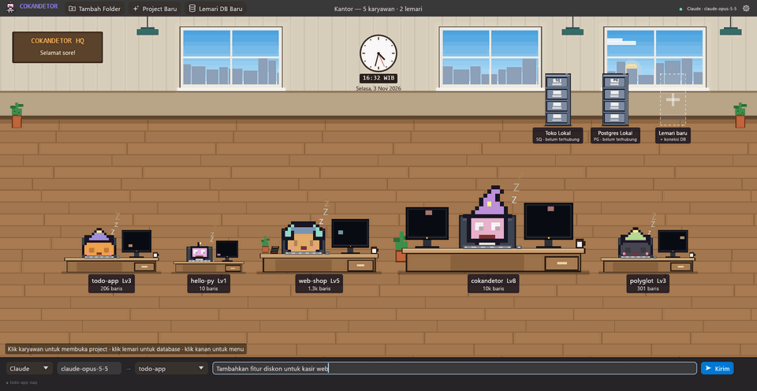
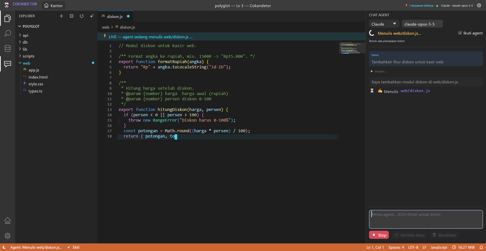
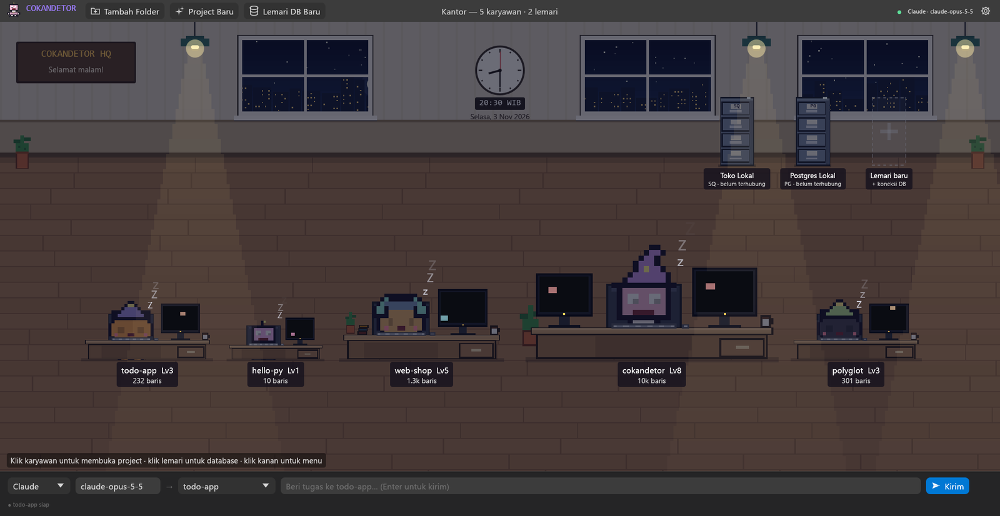
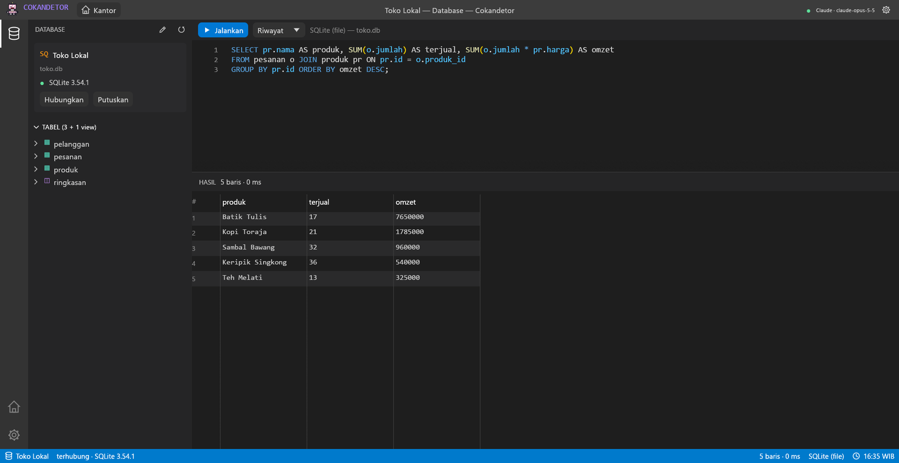
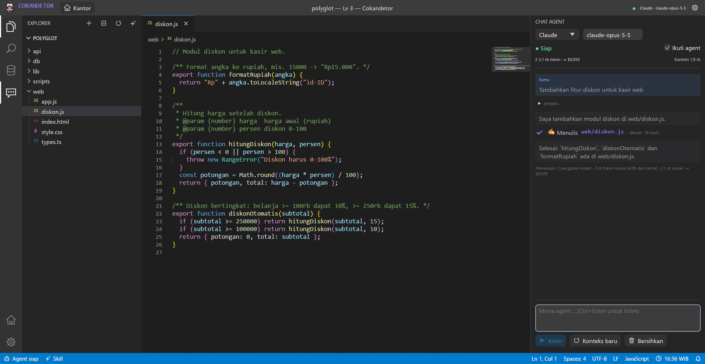

# Cokandetor — Pixel Code Studio



Code editor desktop Windows (Rust + egui) yang berjalan offline, dengan agent AI
(Claude / GPT / model lokal) di dalamnya. Bedanya dengan editor biasa:

- **Kantor pixel.** Setiap project adalah satu karyawan dengan mejanya sendiri.
  Semakin banyak baris kodenya, semakin besar karyawan & mejanya (Level 1–12),
  dan perlengkapannya bertambah: cangkir kopi, tanaman, buku, monitor kedua,
  lalu topi: kupluk → headphone → topi penyihir → mahkota + aura.
  Spesies (coder, robot, slime, kucing) dan warnanya ditentukan dari nama project.
- **Tidur atau mengetik.** Karyawan tanpa tugas tertidur di kursinya (Zzz, monitor
  screensaver). Begitu diberi tugas, ia bangun dan mengetik di depan monitor yang
  menampilkan kode, dengan bubble nama file yang sedang dikerjakan.
- **Waktu Indonesia sungguhan.** Jendela kantor menampilkan langit sesuai jam
  sekarang (WIB/WITA/WIT): pagi, siang dengan matahari & awan, senja, lalu malam
  berbintang dengan bulan dan lampu gedung kota. Malam hari ruangan meredup dan
  lampu gantung menyala. Ada jam dinding analog dan sapaan "Selamat pagi/siang/sore/malam".
- **Lemari penyimpanan = koneksi database.** Setiap lemari di dinding kantor adalah
  satu koneksi ke server database (PostgreSQL, MySQL/MariaDB, atau file SQLite).
  Lampu di atas lemari menunjukkan status (abu-abu belum terhubung, kuning memproses,
  hijau terhubung, merah error). Klik lemari untuk membuka tampilan Database:
  daftar tabel/view & kolom, editor SQL (Ctrl+Enter), grid hasil, dan riwayat query.
- **Editor bergaya VS Code.** Activity bar, Explorer, Search (Ctrl+Shift+F),
  Quick Open (Ctrl+P), tab, breadcrumbs, minimap, indent guide, font
  Consolas/Segoe UI, dan status bar biru (oranye saat agent bekerja).
- **Warna kode per bahasa (tema Dark+).** Grammar dari set `bat` (crate `two-face`):
  Dart, PHP, JavaScript/JSX, TypeScript/TSX, HTML, CSS/SCSS/LESS, Python, Rust,
  Go, Java, Kotlin, Swift, C/C++/C#, Ruby, SQL, JSON, YAML, TOML, Markdown, Vue,
  Svelte, Dockerfile, shell/PowerShell, dan lainnya. Ditambah *bracket pair
  colorization* ala VS Code (kurung emas → ungu → biru per tingkat).
- **Prompt ke Claude / GPT** dari bar bawah kantor atau panel Chat di kanan editor.
  Agent bisa membaca, mencari, menulis, mengedit, dan menghapus file di project.
- **Kode berubah secara realtime.** Saat agent menulis file, isi file di-stream
  langsung ke editor (banner ⚡ LIVE + kursor ketik), lalu baris yang berubah
  di-highlight. Perubahan dari luar (mis. git) juga terdeteksi lewat file watcher.
- **Skill project (`.ckdtr/skill.md`).** Saat project baru ditambahkan dan AI
  terhubung, karyawan baru "onboarding": agent menjelajahi project lalu menulis
  ringkasannya ke `.ckdtr/skill.md`. Setiap tugas berikutnya langsung membawa
  skill ini di awal prompt, jadi agent tidak perlu menjelajah ulang.

## Tampilan

| Kode ditulis live oleh agent | Kantor di malam hari |
|---|---|
|  |  |
| **Lemari = koneksi database** | **Meter token & biaya** |
|  |  |

## Skill project (.ckdtr)

`.ckdtr/` mengikuti pola `.claude/`: folder tersembunyi di root project berisi
`skill.md` (Markdown dengan front matter `name`, `description`, `generated`)
yang berisi ringkasan, teknologi, struktur, perintah build/test, konvensi, file
kunci, dan catatan untuk agent.

- **Kenapa lebih cepat?** Bukan karena ekstensinya — AI membaca `.ckdtr`, `.md`,
  atau `.claude` sama saja. Yang membuat cepat adalah skill itu disuntikkan
  langsung ke system prompt: agent mulai sudah "kenal" project tanpa beberapa
  putaran `list_files`/`read_file`, dan di Claude bagian prompt yang stabil ini
  ikut di-*cache* sehingga tiap langkah lebih murah & cepat.
- **Kompatibel:** `CLAUDE.md`, `.claude/CLAUDE.md`, dan `AGENTS.md` yang sudah ada
  di project juga ikut dibaca agent.
- **Aman:** saat membuat skill, agent hanya boleh membaca file dan menulis
  `.ckdtr/skill.md`; penulisan lain ditolak. Percakapan onboarding tidak
  dicampur ke riwayat chat tugas.
- **Kontrol:** buat/perbarui lewat tombol ✦ di header Explorer, halaman Welcome,
  atau klik kanan meja karyawan; "Lihat skill" membukanya di editor untuk diedit
  manual. Pembuatan otomatis bisa dimatikan di Pengaturan. Commit `.ckdtr/` ke
  git agar tim (dan mesin lain) memakai skill yang sama.

## Hemat token

- **Meter pemakaian.** Panel Chat menampilkan total token & perkiraan biaya
  project (arahkan kursor untuk rinciannya: input, tulis/baca cache, output),
  dan setiap tugas diakhiri satu baris "Pemakaian: …". Biaya dihitung dari harga
  daftar model Claude; GPT ditampilkan tanpa biaya, model lokal "gratis".
- **System prompt yang tetap.** Isinya hanya aturan, skill, dan instruksi
  project. Snapshot file project (yang berubah tiap kali agent menulis) dikirim
  di pesan tugas, dan hanya bila berubah. Karena itu tugas berikutnya membaca
  seluruh percakapan dari cache (di Opus 5.5 harganya 1/20 input biasa), tidak
  membayar penuh lagi.
- **Konteks.** Panel Chat menunjukkan ukuran percakapan agent ("Konteks 45 rb")
  dan memberi peringatan bila sudah besar. Tombol **Konteks baru** membuat
  agent mulai dari awal tanpa menghapus log chat. Bila skill, CLAUDE.md,
  instruksi, atau izin perintah berubah, konteks baru dimulai otomatis: riwayat
  lama tidak bisa memakai cache lagi dan API akan menolak *thinking* lamanya.
  Opsi "Mulai konteks baru di setiap tugas" di Pengaturan adalah mode paling hemat.

## Build

Butuh Rust (stable, MSVC) dan Visual Studio Build Tools dengan workload C++.

```bat
build.bat          :: release build -> target\release\cokandetor.exe
build.bat run      :: build + jalankan
build.bat debug    :: debug build
build.bat test     :: unit test
build.bat clippy   :: lint
```

`build.bat` mencari instalasi Visual Studio yang punya toolset C++ x64 lengkap
lalu memuat environment-nya sebelum memanggil `cargo`. Kalau environment Anda
sudah benar, `cargo build --release` biasa juga cukup.

## Menghubungkan AI

Buka **⚙ Pengaturan**:

| Provider | Yang diisi |
|---|---|
| Claude (Anthropic) | API key (atau env `ANTHROPIC_API_KEY`), model default `claude-opus-5-5` |
| GPT (OpenAI) | API key (atau env `OPENAI_API_KEY`), model default `gpt-5` |
| Lokal / OpenAI-compatible | Base URL, mis. `http://localhost:11434/v1` (Ollama) — mode offline penuh |

Untuk Claude, request memakai streaming SSE ke Messages API dengan adaptive
thinking (ringkasan tampil di chat), `effort` yang bisa diatur, prompt caching,
`eager_input_streaming` pada tools (agar isi file ter-stream live), dan refusal
fallback server-side (`fallbacks: "default"`). Fitur opsional yang ditolak
endpoint (misalnya lewat proxy) otomatis dimatikan lalu request diulang.

Opsi `run_command` (agent menjalankan perintah `cmd`) **mati secara default**;
aktifkan di Pengaturan bila perlu.

## Database

Klik lemari kosong bertanda **+** (atau tombol **🗄 Lemari DB Baru**) lalu isi:
jenis database, host/port/user/password/nama database (atau file untuk SQLite),
dan mode SSL/TLS:

- **Mati** — tanpa enkripsi.
- **Jika ada** — enkripsi bila server mendukung, tanpa memverifikasi sertifikat
  (sama seperti `psql`/`mysql` bawaan).
- **Wajib** — enkripsi wajib dan sertifikat diverifikasi, kecuali opsi
  "percayai sertifikat server" dicentang (untuk sertifikat self-signed).

TLS memakai SChannel bawaan Windows. Query berjalan di thread terpisah per
lemari dan hasilnya di-stream; tabel hasil dibatasi 2.000 baris per query.
Error SQL biasa tidak memutus koneksi (transaksi yang sedang terbuka tetap
aman). File SQLite harus sudah ada — path yang salah ketik tidak akan membuat
database baru. Klik kanan lemari untuk mengedit atau menyingkirkannya
(database-nya sendiri tidak disentuh).

## Data

- Config, daftar project & lemari: `%APPDATA%\Cokandetor\config.json`
  (API key dan password DB disimpan sebagai teks biasa — gunakan env var
  atau user DB read-only bila tidak ingin begitu).
- Riwayat chat per project: `%APPDATA%\Cokandetor\sessions\`.
- Set env `COKANDETOR_HOME` untuk memakai folder data lain (berguna untuk uji coba).
- Zona waktu (WIB/WITA/WIT) dan "Pratinjau jam" untuk melihat suasana siang/malam
  ada di Pengaturan → Kantor.

## Struktur kode

| File | Isi |
|---|---|
| `src/app.rs` | State aplikasi, event agent → editor live, file watcher, dialog Pengaturan & lemari |
| `src/office.rs` | Kantor pixel: dinding, jendela & langit, jam, lampu, meja karyawan, lemari, prompt bar |
| `src/clock.rs` | Jam WIB/WITA/WIT, kalender, warna langit & tingkat cahaya siang/malam |
| `src/sprite.rs` | Generator karakter pixel prosedural + ikon aplikasi |
| `src/editor.rs` | Workbench ala VS Code: activity bar, Explorer, Search, Quick Open, tab, minimap, editor kode, LIVE |
| `src/dbview.rs` | Tampilan Database: tabel/kolom, editor SQL, grid hasil |
| `src/db.rs` | Koneksi PostgreSQL / MySQL / SQLite di worker thread |
| `src/theme.rs` | Warna Dark+, font Windows, tema syntax Dark+ |
| `src/chat.rs` | Panel chat agent |
| `src/agent/` | Loop agent, klien Claude & OpenAI (streaming), tools file, hitung token & biaya (`usage.rs`) |
| `src/partial_json.rs` | Parser JSON parsial untuk preview isi file yang sedang di-stream |
| `src/project.rs` | Scan project, hitung baris, level |

## Lisensi

[MIT](LICENSE) © 2026 Andika Kurniawan.
